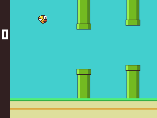

# flappy6502

Flappy Bird on a breadboard computer: Rockwell R6502 (NMOS), 28C64 EEPROM, 32 KB SRAM,
74LS00 decoder, a 74LS161 as the LCD port, and a SmartElex 2" ST7789 IPS LCD driven by
bit-banged SPI. One button (NMI) flaps.

**Status (2026-10-27): working on the real hardware.** `build/flappy_bb.bin`, played at
1 MHz (about 10.8 frames/s; 13.6 at 1.25 MHz).



## Repository layout

| Folder | What |
|---|---|
| `asm/` | 6502 sources (ca65): the game, the LCD drivers, hardware test programs |
| `roms/` | prebuilt 8 KiB EEPROM images, ready to flash (`flappy_bb.bin` is the game) |
| `hardware/` | wiring for every stage, pin maps, the final LCD wiring |
| `docs/` | design plan and project handoff notes |
| `tools/` | graphics generator, 6502 simulator, smoke test, profiler, PNG writer |
| `programmer/` | Nano28C64 EEPROM programmer CLI and firmware (MIT), used by `./flash` |

The ST7789 module datasheet (SmartElex LHS200KP-IF05) is not included; get it from the vendor.

## Build and flash

```bash
python3 tools/gfx.py        # bird sprite + colours -> asm/gfx.inc (only after editing art)
make                        # assemble asm/*.s -> build/*.bin (cc65 in ~/.local/opt/cc65)
./flash roms/flappy_bb.bin  # Nano28C64 programmer: write, verify, re-verify (or build/ after make)
uv run python tools/smoke2.py bb   # simulator: boot screen + frames/s
uv run python tools/profile.py     # simulator: cycles per frame stage
```

## Hardware docs (`hardware/`)

| File | What |
|---|---|
| `clock.txt` | 10 MHz crystal + 74LS04 oscillator, 74LS161 divider (QC = 1.25 MHz, QD = 625 kHz) |
| `cpu_r6502.txt`, `full_pinmap.txt` | CPU pins and the full pin map |
| `stage2_rom_decoder_latch.txt` | EEPROM, decoder, LCD latch |
| `stage3_sram.txt` | SRAM |
| `lcd_final.txt` | **final LCD wiring** (no 5 V into the module; RST/EN from a 74LS04 after /RES; 10 pF on the latch clock) |
| `stage5_button.txt` | flap button on NMI |
| `board_link.txt` | wires between the two breadboards |
| `stage7_autoclock_spi.txt`, `stage6_spi_shifter.txt` | faster SPI options for later (need a 74LS00/74HCT00 or a 74HC165) |

## Game

- `asm/flappy.s`: the game; `asm/flappy_bb.s` builds it for the bit-banged wiring.
- `asm/lcd2.inc`: the ST7789 driver, with the same init sequence as the ESP32 oreoWare driver.
- 320x240 landscape. The world moves with the panel's hardware scroll. A fixed 20 px strip shows the live score.
- 12-bit colour. The bird is compiled into RAM at boot. Pipes redraw only the rows that change.
