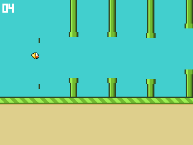

# Record evidence: Flappy Bird in 1,024 bytes on a self-built R6502 computer

**Claim:** First and smallest full-colour video game running on a self-built breadboard
computer with an original 1980s 8-bit microprocessor and no firmware: Flappy Bird in
1,024 bytes.

**Maker:** Ayushman Bhattacharya, Kolkata, West Bengal, India.



*The game in the board simulator, which shows exactly what the LCD receives. The
real-hardware video is linked below.*

## 1. The program is 1,024 bytes

| | |
|---|---|
| Source | [`asm/flappy1k.s`](../../asm/flappy1k.s) (ca65 6502 assembly) |
| Image | [`roms/flappy1k.bin`](../../roms/flappy1k.bin): the full 8 KiB 28C64 EEPROM image |
| Program | `$FC00`-`$FFFF`: 1,018 bytes of code and data, plus the 6-byte 6502 vector table = **1,024 bytes** |
| Rest of the chip | `$E000`-`$FBFF`: 7,168 bytes, every one `$FF` (erased) |
| SHA-256 | `0c767f7ec1f350c5036ee9f3e12fa9c02a377c4b41b99e4e00320dd6713cd228` |
| CRC32 | `93123A0A` |

The limit is enforced by the build. [`asm/rom1k.cfg`](../../asm/rom1k.cfg) gives the
linker exactly 1,024 bytes; one byte more and the build fails.

Where the bytes go:

| Part | Bytes | What it does |
|---|---:|---|
| `reset` + init | 44 | clear zero page, run the LCD command table |
| `boot` | 110 | draw sky, striped grass, dirt; first bird and score |
| `dead` | 25 | game over: wait for the button, new game |
| `loop` | 126 | one frame: gravity, collision, scoring, scrolling, new pipes |
| `pipe`, `cap` | 86 | draw two pipe columns: body, cap, gap, cap, body |
| `bird` | 110 | draw the 12x11 sprite over the rows it left and entered |
| `score2`, `digit` | 122 | two-digit score, 3x5 font at 3x scale |
| `px`, `run`, `fill` | 120 | colour runs: 12-bit colour to latch values, bit-banged pixels |
| `win`, `dat`, `cmd`, `send` | 71 | ST7789 window and command bytes over bit-banged SPI |
| `bgap`, `rnd`, `delay` | 48 | pipe at the bird, random gaps, waits |
| LCD init table | 23 | NOP, SLPOUT, COLMOD, MADCTL, VSCRDEF, INVON, DISPON |
| palette, pipe shades | 40 | 12 colours, cap and body shading |
| bird sprite | 66 | 12x11 pixels, 4 bits each |
| font | 20 | digits 0-9 |
| NMI handler | 7 | the button: flap |
| vectors | 6 | NMI, RESET, IRQ |
| **Total** | **1,024** | |

## 2. No firmware

The computer has no BIOS, monitor, KERNAL or operating system. After reset, the 6502
reads its reset vector from the EEPROM and runs the game; nothing else is on the
chip. Everything that runs is in the 1,024 bytes above: the LCD start-up sequence,
the SPI protocol (bit-banged one bit at a time through a 74LS161 latch), the graphics,
the game and the button handler.

Anyone can check this from the image. Everything outside the program is `$FF`:

```bash
python3 -c "d=open('roms/flappy1k.bin','rb').read(); print(all(b == 0xFF for b in d[:0x1C00]))"
```

On the real chip, the programmer reads the EEPROM back and compares it byte for byte
(`./flash` programs, verifies, reconnects and verifies again).

## 3. Self-built computer, original 1980s CPU

- **CPU:** Rockwell R6502P, an original NMOS 6502, at 1.25 MHz: a 10 MHz crystal divided by 8 in a
  74LS161.
- **Memory:** 28C64 EEPROM (8 KiB) and 62256 SRAM (32 KiB). There is no VIA, ACIA or
  other support chip.
- **Logic:** a 74LS00 address decoder, a 74LS161 as the LCD output port, and a 74LS04.
- **Display:** a 2" 320x240 ST7789 IPS LCD in 12-bit colour, driven entirely by
  software.
- **Input:** one button on the NMI line.
- **Construction:** hand-wired on breadboards. The full schematic is
  [`hardware/flappy6502_schematic.pdf`](../../hardware/flappy6502_schematic.pdf), with
  the wiring for every stage in [`hardware/`](../../hardware/).
- **Third-party listing:** [6502.org Homebuilt Projects](http://www.6502.org/homebuilt/),
  as "Ayushman's Flappy Bird on a Breadboard R6502".

## 4. Playable

The player gets:

- one-button flap, gravity, and a capped falling speed
- pipes with random gaps, scrolled with the LCD's hardware scroll
- collision with pipes, the ground and the top of the screen
- a two-digit score
- game over, then restart on the next press

It runs at about 10.4 frames per second at 1.25 MHz.

Video of the real hardware, unedited from power-on through play, a crash and a restart:
**[link to be added]**

## 5. Reproduce it

```bash
make build/flappy1k.bin          # needs cc65; prints "flappy1k: 1024 of 1024 bytes"
sha256sum build/flappy1k.bin     # same hash as roms/flappy1k.bin
uv run python tools/sim1k.py     # 6502 simulator + LCD model: boot, play, score, crash, restart
./flash roms/flappy1k.bin        # Nano28C64 programmer: write, verify, re-verify
```

## 6. Prior art and why this is a different category

These are the smallest Flappy Bird games found before this one:

| Game | Size | Machine | Firmware it relies on |
|---|---|---|---|
| [Flappy Bird 256](https://csdb.dk/release/?id=229405) by Ko-Ko (Lovebyte 2023) | 256 bytes | Commodore 64, factory-made | KERNAL/BASIC ROM, VIC-II text mode and character set |
| [flappy-512](https://github.com/eklavya-raj/flappy-512) | 506 bytes | x86 PC boot sector | BIOS: video mode, text printing and font, keyboard, timer |
| [Flappy](https://atariage.com/store/index.php?l=product_detail&p=1038), Atari 2600 | 4 KiB | Atari 2600, factory-made | none |
| [Flapple Bird](https://github.com/digarok/flapple), Apple II | larger | Apple II, factory-made | Apple II ROM |

All of them run on factory-made machines, and the smaller ones lean on firmware for
the screen, the font and input: thousands of bytes that their size does not count.
This game runs on a computer built by hand from individual chips, and its 1,024 bytes
include everything, down to the LCD driver.

## 7. Also in this repository

- **[`roms/flappy_bb.bin`](../../roms/flappy_bb.bin):** the full-size game this
  started from. It has 12-bit colour graphics and a bird compiled into RAM, and it
  runs about 13.6 frames per second.
- **[`roms/flappy512.bin`](../../roms/flappy512.bin):** a black-and-white 512-byte
  version. It has white blocks and a score bar, with no colour and no digits.
